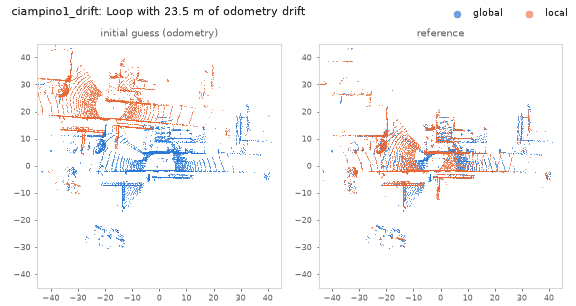
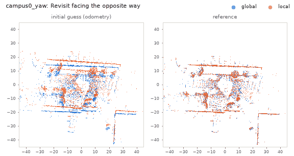
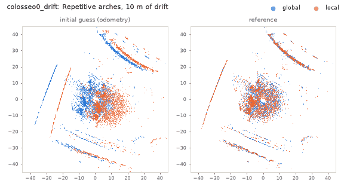
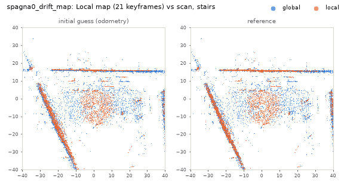
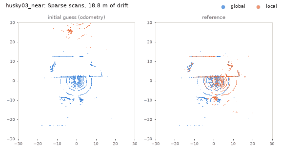
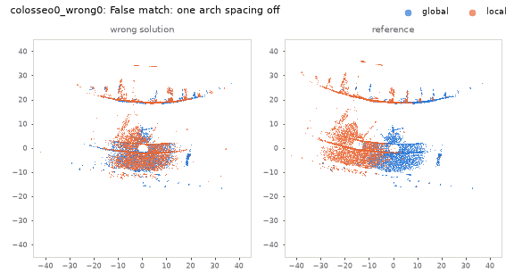
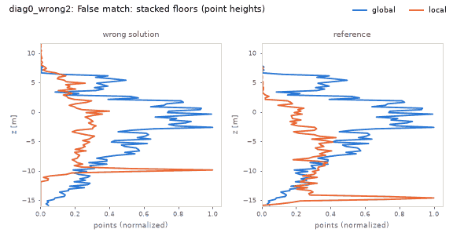
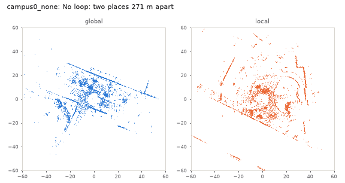

# Loop closure registration cases

Pairs of point cloud fragments (`.mm` metric maps) with their relative pose, for
unit tests and benchmarks of loop closure registration: global registration
(no initial guess, or a drifted one) followed by ICP.

| Set | Cases | loop | wrong_match | no_loop | Fragments | License |
|---|---|---|---|---|---|---|
| `vbr/` | 55 | 40 | 7 | 8 | single scans and 21-keyframe local maps from the 8 VBR training sequences | CC BY-SA 4.0 |
| `husky/` | 12 | 11 | 0 | 1 | sparse scans and local maps from two Husky A200 outdoor loop runs | CC BY 3.0 |
| `dataset.yaml` (`kitti*`, `mulran*`) | 7 | | | | local map pairs with good and bad ICP solutions | see `../kitti`, `../mulran` |

The odometry initial guesses are off by up to 23.5 m (vbr) and 38 m (husky).

## Examples

Global fragment in blue, local fragment in orange, top view (axes in meters, in
the frame of the global keyframe). Left: the initial guess from odometry, or a
wrong solution a registration method returned. Right: the reference pose.

**Loops**







**False matches and non-loops**



Stacked floors with the same layout look aligned from above; the height
histograms (gravity-aligned) show the local fragment one floor off at the true
pose:




## File format

Each `cases.yaml` has a list `cases`. Poses are `[x, y, z, yaw, pitch, roll]`
(meters, degrees) of the `local` fragment frame seen from the `global` one.

```yaml
cases:
  - name: campus0_drift            # <sequence>_<what makes it hard>
    kind: loop                     # loop | wrong_match | no_loop
    global: vbr/campus0_kf0003.mm  # relative to this directory
    local: vbr/campus0_kf1245.mm
    reference_pose: [...]          # ground truth refined by ICP
    reference_quality: 0.761       # ICP paired ratio of that refinement
    gt_pose: [...]                 # ground truth before refinement
    initial_guess_odometry: [...]  # what a SLAM back end would use
    global_odometry_pose: [...]    # keyframe poses in the gravity-aligned
    local_odometry_pose: [...]     # odometry frame (roll and pitch are absolute)
    wrong_solutions:               # wrong_match only: known wrong answers
      - [...]
    gt_distance: 0.56              # distance between both keyframes [m]
    odometry_error: [6.88, 2.0]    # of the initial guess [m, deg]
```

- `loop`: the fragments overlap; a registration must find `reference_pose`.
- `wrong_match`: little or no overlap at the true pose (stacked floors), or
  repetitive structure; `wrong_solutions` were accepted by a registration method
  in the original runs. Its `reference_pose` is the true relative pose.
- `no_loop`: far apart; a registration must report failure.
- Names: `yaw` (revisit facing another way), `drift` (largest odometry error),
  `far` (partial overlap), `near`, `typical`, `extra<N>`, `wrong<N>`, `none`;
  `_map`: the global side is a local map of 21 keyframes.

Fragments have one point layer, `points`: de-skewed, range limited to
[1, 80] m and voxel decimated to 0.25 m, in the frame of the (central)
keyframe. Load them with `mp2p_icp::metric_map_t::load_from_file()`.

## Provenance and licenses

- `vbr/`: from the VBR dataset (Brizi et al., ICRA 2024,
  https://github.com/rvp-group/vbr-devkit), CC BY-SA 4.0 as the original, with
  redistribution confirmed by its authors. See `vbr/README.md`.
- `husky/`: University of Almeria, CC BY 3.0. Reference poses from RTK GNSS and
  ICP between local maps; no geographic coordinates are included. See
  `husky/README.md`.
- `images/`: figures of the cases above, same licenses as their sets.
